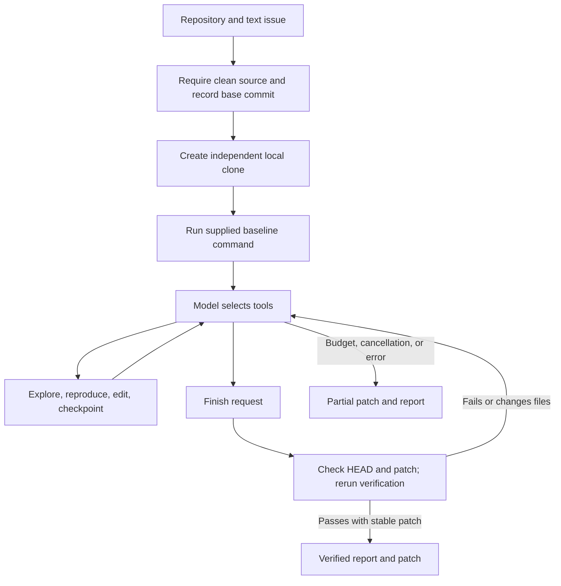

# How Forge decides a patch is ready

A basic agent loop accepts the model's completion message after edits and tool calls. That leaves a gap: a passing test may describe an earlier version of the files. Forge makes completion an operation the runner can reject.

The `finish` tool requires a nonempty patch and an unchanged repository HEAD. It executes the selected verification command again and compares worktree fingerprints before and after that command. Completion succeeds only when the command exits successfully, does not time out or get cancelled, and leaves the patch unchanged. Edits made after an earlier `verify` call therefore require fresh evidence at `finish`.

This rule does not establish that tests are complete or resistant to manipulation. Forge rejects a few obviously empty commands, but it cannot prove that an arbitrary command meaningfully tests the issue. The strongest evaluation supplies its own test command and independent hidden tests.

## Components and execution

`forge/core.py` owns a run and its model conversation. `forge/provider.py` sends requests to the configured Chat Completions endpoint. `forge/tools.py` performs file operations and command execution. The CLI and local dashboard call the same `Run` implementation.

When no verification command is supplied, the model selects one with `verify`. Forge keeps that command for final verification. The initial failing baseline is evidence when available, but a baseline failure is not a hard completion requirement.

The six repository tools list files, search literal text, read numbered lines, replace a unique exact string, write a file, and run a command. Three run tools record checkpoints, verify, and finish. File edits reject ambiguous matches. Commands record exit status, duration, output, and fingerprints before and after execution.

Git creates the final diff, including untracked files, symlinks, binary changes, and executable modes. Patch export does not stage the agent's changes. Each run has its own clone rather than a shared branch or index.

## Context and failure recovery

Repository discovery starts with a bounded file inventory. The system instruction asks the model to inspect narrowly, read repository instructions, reproduce the issue, and preserve existing tests. Checkpoints save a concise phase and durable notes.

When serialized conversation history reaches 65,000 characters, Forge preserves the initial instructions, recent complete tool exchanges, checkpoint notes, and recent verification evidence. Older observations are removed. This compaction is separate from `checkpoint.json`, which saves the conversation and current Git patch fingerprint before each request and after tool execution. `forge resume` copies the retained workspace into a new attempt with fresh budgets, preserves the previous report, and pins the same model and endpoint. It rejects changed HEAD or patch-visible files. Ignored dependencies and generated files are outside that fingerprint. Archived reports are visible after a dashboard restart; resume is available through the CLI.

Identical tool calls are blocked after three repetitions, except `verify` and `finish`. The provider retries selected rate-limit and server errors up to three attempts, with retry delays bounded at 60 seconds. Google's RetryInfo is supported in both object and array error envelopes. Daily quota exhaustion stops immediately. It does not fall back to a different model. Malformed provider responses fail the run with an error report.

## Budgets and cancellation

The default run permits 40 model steps, 120,000 total input and output tokens, and 900 seconds. A step is one model response and can contain multiple tool calls. If usage is missing, a character-based estimate contributes to the token budget and is marked as estimated.

The runner checks budgets before and after model responses and between actions. A request already in progress can exceed a time or token budget. HTTP calls are synchronous and cannot be interrupted by the dashboard's Stop button; cancellation waits for the provider call or its timeout and retry handling to return. Returned actions are discarded once cancellation or a spent budget is detected.

Commands poll cancellation at intervals of at most 0.1 seconds. Timeout or cancellation terminates the process group. Descendants that remain in that group are also cleaned up after a successful command. Commands can escape that group deliberately, so this is process management rather than sandbox isolation.

## Status and evidence

| Status | Meaning |
| --- | --- |
| `queued` | Run exists and has not started execution. |
| `running` | Workspace creation, model calls, or tools are active. |
| `verified` | A nonempty patch passed final verification without changing during the command. |
| `budget_exhausted` | Step, token, or time allowance ended before verified completion. |
| `cancelled` | Cancellation was observed and partial work was retained. |
| `failed` | An error prevented execution or completion. |

The CLI returns `0` for a verified solve or successful fixture suite, `1` for an unverified run or failing suite, `2` for entry-point input errors, and `130` for a keyboard interrupt. Validation errors caught inside a run appear as `failed` reports and return `1`.

Each run directory contains the cloned `workspace/`, `patch.diff`, `report.json`, `report.md`, `events.jsonl`, `checkpoint.json`, and command logs under `artifacts/`. Events record model-visible content, actions, command results, phases, usage, and completion. They do not expose a model's private internal reasoning. Console output is capped, while complete command output is saved as an artifact.

## Configuration

| Variable | Default | Effect |
| --- | --- | --- |
| `AI_API_KEY` | Required for live runs | Provider credential, read from the environment. |
| `AI_MODEL` | `gemini-3.8-flash` | Model identifier sent on every request. |
| `AI_BASE_URL` | `https://generativelanguage.googleapis.com/v1beta/openai` | Base URL; Forge appends `/chat/completions`. |
| `AI_TOKEN_PARAMETER` | `max_tokens` | Response budget field; also accepts `max_completion_tokens`. |
| `AI_MAX_OUTPUT_TOKENS` | `4096` | Maximum requested output tokens per response. |
| `AI_TIMEOUT` | `90` | Provider HTTP timeout in seconds. |
| `AI_REQUEST_INTERVAL` | `0` | Minimum seconds between provider attempts; accepts 0 through 60. |
| `AI_TEMPERATURE` | Unset | Optional numeric temperature. |
| `FORGE_RUNS_DIR` | `.forge/runs` under the current directory | Run artifact directory. |

The endpoint requires HTTPS except for loopback HTTP test servers. Redirects are rejected to avoid forwarding credentials elsewhere. Provider error bodies are excluded from error messages. The compatibility contract follows [Google's OpenAI interface](https://ai.google.dev/gemini-api/docs/openai) and the [Chat Completions reference](https://developers.openai.com/api/reference/resources/chat).

## Trust boundary

File tools resolve paths against the cloned repository and block escapes, Git internals, and common secret filenames. Subprocess environments omit secret-like variable names, including `AI_API_KEY`. Known secret environment values are redacted from command evidence and complete command logs on a best-effort basis.

The shell is unrestricted local execution. Command guards reject a small set of dangerous commands but cannot secure hostile code. Shell execution can access host files and the network, and unknown secrets in source files or generated patches may still appear in artifacts. A repository clone is an isolation mechanism for Git state, not a sandbox for the host. Run untrusted projects in a disposable container or VM and inspect exported artifacts before sharing them.

The dashboard binds to `127.0.0.1`, validates Host and Origin on writes, and runs one task at a time. It is a local operator interface without an authentication system. Do not expose it publicly through a reverse proxy.
